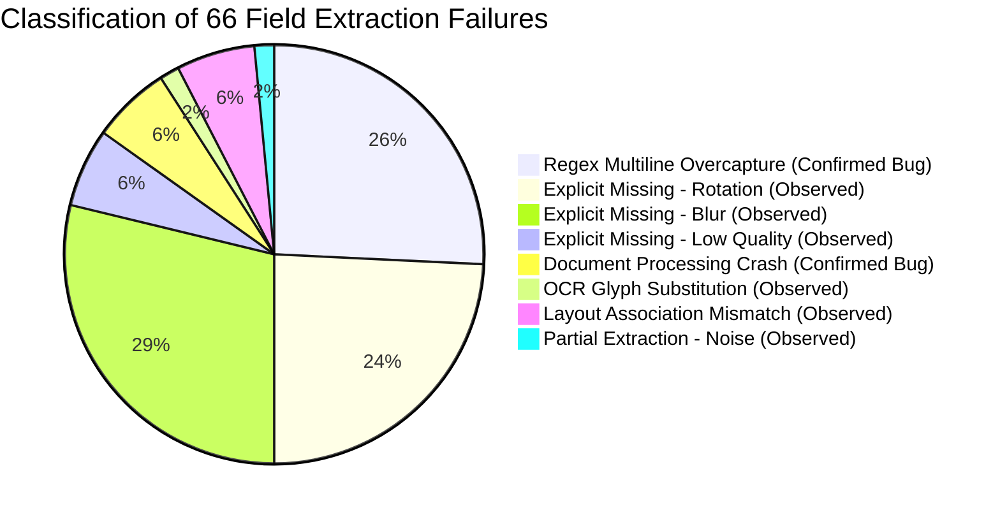

# DocuFlow M3: OCR & Document Extraction Root Cause Error Analysis

**Document Version:** 1.1.0 (Audited & Verified)  
**Assigned Working Directory:** `team_contributions/M3_ocr_evaluation/`  

---

## 1. Overview of Failure Classifications

Detailed audit of the 66 observed field extraction failures classifies them into confirmed implementation bugs, verified schema constraints, and empirically observed engine limitations:



---

## 2. Technical Root Cause Findings

### Finding 1: Regex Alias Multiline Overcapture (Confirmed Implementation Bug)
- **Classification:** Confirmed Implementation Defect
- **Code Reference:** `app/processors.py` lines 14-19 and lines 81-86:
  ```python
  ALIASES = {
      "name": ("name", "customer", "customer_name", "bill_to"),
      ...
  }
  ...
  for field, aliases in ALIASES.items():
      labels = "|".join(a.replace("_", "[ _-]+") for a in aliases)
      match = re.search(rf"^\s*(?:{labels})\s*[:#]\s*([^\r\n]+)", text, re.I | re.M)
      record[field] = match.group(1).strip()[:500] if match else ""
  ```
- **Observed Evidence:**
  Across all clean documents (`DOC_001`–`DOC_005` text PDFs and `DOC_011`–`DOC_015` clear images), the ground truth expected `"Sarah Jenkins"`, but the extracted value was `"Name: Sarah Jenkins"`.
- **Root Cause:**
  `ALIASES["name"]` includes `"bill_to"`. Standard invoice layouts place `"BILL TO:"` on its own line followed by `"Name: Sarah Jenkins"` on the next line.
  Because `re.search` uses multiline mode `re.M`, `(?:bill[ -]+to)\s*[:#]` matches `"BILL TO:"`. The subsequent `\s*` matches the trailing newline, causing group 1 `([^\r\n]+)` to capture the entire following line `"Name: Sarah Jenkins"`.

---

### Finding 2: Rotation Degradation & Crash (Confirmed Limitation & Handling Defect)
- **Classification:** Confirmed Architecture Limitation & Error Handling Defect
- **Code Reference:** `app/processors.py:46-48` and `app/processors.py:79-80`
- **Observed Evidence:**
  - `DOC_021` (5°): Fields extracted successfully.
  - `DOC_022` (15°), `DOC_024` (90°), `DOC_025` (180°): Text stream returned empty or unparseable; all 4 supported fields were missing.
  - `DOC_023` (30°): Raised unhandled `ValueError("No readable text was found.")`, resulting in a fatal job failure.
- **Root Cause:**
  DocuFlow passes raw image buffers directly to Tesseract without deskewing or page orientation detection. In the tested synthetic layouts, angles $\ge 15^\circ$ caused complete recognition collapse, and $30^\circ$ triggered a fatal exception.

---

### Finding 3: Gaussian Blur Degradation Threshold (Empirical Observation)
- **Classification:** Empirical Quality Limitation (Specific to Tested Dataset)
- **Observed Evidence:**
  - `DOC_016` (Radius 1.5): Only `total` was extracted; `name`, `date`, `invoice_number` were missing.
  - `DOC_017`–`DOC_020` (Radii 2.5, 3.5, 4.5, 5.5): 100% of fields were missing.
- **Root Cause:**
  Gaussian smoothing softens high-frequency character edge gradients. When passed to Tesseract's standard Otsu binarizer without pre-sharpening, glyphs dissolve into background noise.

---

### Finding 4: Numeral Character Substitution (Empirical Observation)
- **Classification:** Empirical Quality Limitation
- **Observed Evidence:**
  In `DOC_027` (downsampled 3x), expected total `"4890.50"` was extracted as `"4690.50"`.
- **Root Cause:**
  Downsampling and interpolation severed the central crossover pixel of the numeral `'8'`, converting it to a `'6'`. The downstream validator accepted `4690.50` because it met standard decimal format checks.

---

### Finding 5: Unsupported Field Schema (Confirmed Architectural Limitation)
- **Classification:** Confirmed Design Limitation
- **Code Reference:** `app/processors.py:13`: `FIELDS = ("name", "date", "invoice_number", "total")`
- **Observed Evidence:**
  Across all 30 documents, `due_date`, `email`, `phone`, `tax`, and `currency` were present in the documents but omitted from extraction by design.
